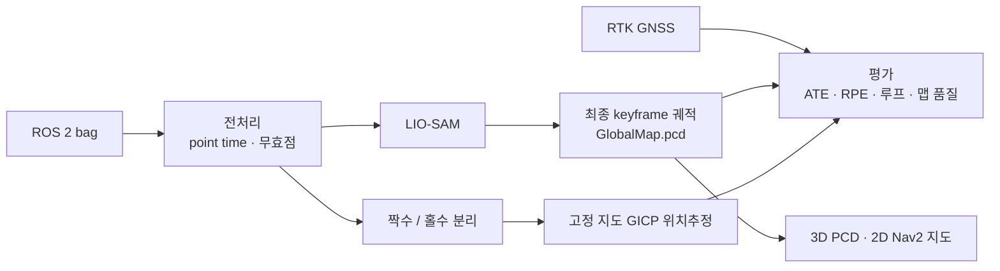

# LIO-SAM 루프 매핑과 RTK 기준 정확도 평가

전방 128채널 LiDAR와 IMU로 기록한 237 m 폐루프를 LIO-SAM(ROS 2 Humble)으로 매핑하고, 매핑에 쓰지 않은 RTK GNSS(σ≈1.4 cm)를 정답으로 궤적 정확도, 루프 클로저 효과, 지도 기반 재주행 위치추정을 평가했다.

LIO-SAM 알고리즘은 수정하지 않았다. 전처리, 설정, 실행 자동화, 궤적 기록, 평가, 지도 내보내기, 위치추정을 직접 구현했다.

- 상세 보고서(수치별 출처 포함): [report/REPORT.md](report/REPORT.md)
- 재현 절차(영문): [REPRODUCE.md](REPRODUCE.md)
- 설계와 리뷰 기록: [TASKS.md](TASKS.md)

## 핵심 결과

| 지표 | 결과 |
|---|---|
| 2D ATE RMSE, 루프 ON / OFF (각 n=3) | **0.306 ± 0.114 m** / 0.389 ± 0.220 m |
| 100 m 구간 RPE (yaw-only) | 1.47 % |
| 루프 제약 GT 일관성 | 9 / 9 쌍 |
| 재주행 위치추정 (지도에 안 쓴 스캔 1,089개) | 위치 상실 0회, 2D ATE 0.259 m, 실시간 계수 1.21× |
| 초기 오차 수렴률 0.5 m·2° / 1 m·5° / 2 m·10° / 3 m·15° | 100 / 100 / 96 / 64 % |

ATE는 SE3 정렬(스케일 없음)과 GNSS 안테나 수평 lever arm 적합을 함께 적용한 값이다. lever는 평가 GT에서 추정했으므로 낙관적인 수치이며, SE3 정렬만 적용한 ATE는 0.72 m다. 루프 클로저의 평균 개선(21%)은 반복 간 표준편차보다 작아 유의하다고 볼 수 없다. 재주행 평가는 같은 주행을 짝수/홀수 스캔으로 나눈 것이라 실제 다른 날 재주행보다 낙관적이다.


## 데이터

| 센서 | 주기 | 메시지 | 비고 |
|---|---|---|---|
| LiDAR (128 ring, 전방 약 120° FOV) | 20 Hz | 2,178 | 무효점 50.5% |
| IMU (9축) | 100 Hz | 10,884 | |
| RTK GNSS | 32 Hz | 3,298 | 평가 전용, 매핑 입력 아님 |

주행 1회(108.7 s), 약 70 × 60 m 사각 경로, 평지. 원본 rosbag은 공개하지 않는다.

## 파이프라인



## 해결한 문제

| 문제 | 원인과 조치 | 결과 |
|---|---|---|
| 포인트 시간이 epoch 기준으로 기록됨 | 헤더와 169,765,152 s 일정 오프셋 확인 → 스캔 내 상대시간(0–25 ms)으로 변환 | deskew 동작 |
| 캘리브레이션 회전 방향 | LiDAR 지면 법선과 IMU 중력 비교 | 전치 적용 시 0.55°, 미적용 시 18.8° |
| `extrinsicRPY` 설정 오류로 궤적 발산 | 소스의 변환식에서 `extRPY · extRot = I` 조건 도출 | 중력축 오차 18.57° → 0.095°, 누적거리 2,089 m → 235 m |
| RPE 17% | LiDAR 9.3° 장착 pitch가 평면 GT와 비교됨 → yaw-only 비교 | 1.47 % |
| GNSS lever arm 발산 | 평면 주행에서 수직 성분 관측 불가 → 수평 2-DoF | lx = −1.56 ± 0.07 m (7 runs) |
| 루프 오검출 판정 | keyframe 거리 대신 상대 위치와 GT 상대 위치 차이(< 0.5 m)로 판정 | 9 / 9 일관 |
| `save_map`의 `rm -r` 동작 | 실행 래퍼에서 전용 하위 경로만 허용 | 경로 보호 테스트 포함 |

## 지도

| 3D 점군 지도 | 2D 점유 격자 (Nav2, 0.05 m) |
|---|---|
|  |  |


## 저장소 구성

```text
config/   LIO-SAM 파라미터 (기본, 루프 OFF)
launch/   xacro 없이 실행하는 launch
tools/    전처리 · 실행 · 기록 · 평가 · 지도 · 위치추정 · 리포트 (pytest 77개)
results/  실행별 궤적·지표·로그, 평가 요약, 지도 메타데이터, 이전 버전 아카이브
report/   보고서, 그림, 수치 출처 JSON, 웹 리포트
logs/     빌드·작업·Codex 실행 로그
```

### 저장소에 포함하지 않은 것

- **원본/전처리 rosbag (`data/`)**: 비공개.
- **PCD·PGM·NPZ 결과 파일**: 용량 때문에 [GitHub Release](https://github.com/hkj0878-art/autonomous-driving-portfolio/releases/tag/lio-sam-integration-v1)에 zip으로 첨부했다. 압축을 이 폴더에 풀면 `results/` 경로가 그대로 복원된다.
- **업스트림 소스와 빌드 산출물**: 수정 없이 아래 커밋을 사용했다.
  - LIO-SAM `ros2` 브랜치 [`08af3f3`](https://github.com/TixiaoShan/LIO-SAM/tree/08af3f32f01725372d4269838dc44c19c6d9e76b) → `ws/src/LIO-SAM`
  - GTSAM 4.1.1 [`69a3a75`](https://github.com/borglab/gtsam/tree/69a3a75195b65356d6e56669e5199d325c7962c9) → `third_party/gtsam`
- **Python venv (`.venv/`)**: [report/requirements.txt](report/requirements.txt)로 재생성.

## 한계

- 주행 데이터가 1회뿐이며, 재주행 평가는 같은 주행을 나눠 쓴 것이다.
- GT 자세는 GNSS 궤적 접선 yaw와 평지 가정으로 근사했다.
- lever arm은 평가 GT에서 추정했다. 실측 장착값과 비교가 필요하다.
- 평가용 지도 재구성과 위치추정에는 deskew를 적용하지 않았다.

Ubuntu 22.04 · ROS 2 Humble · LIO-SAM · GTSAM 4.1.1 · Open3D 0.20 · evo
