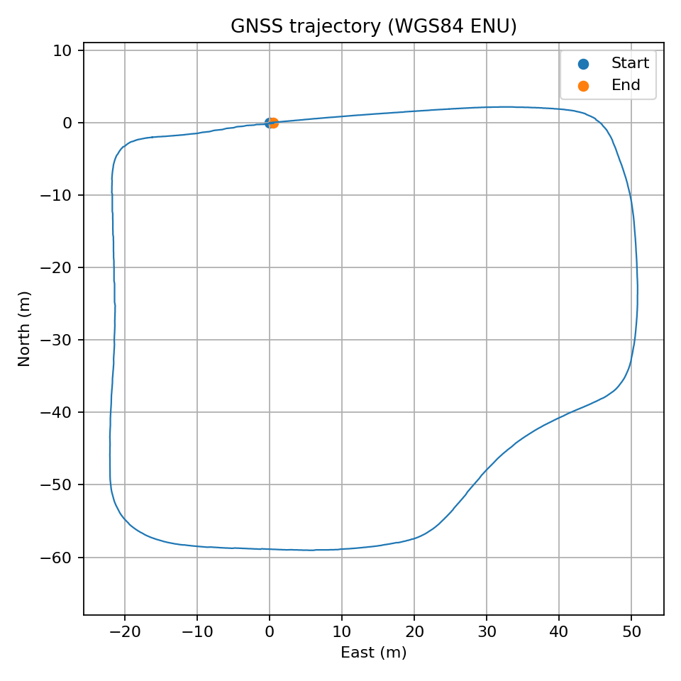
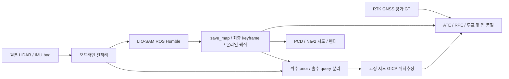
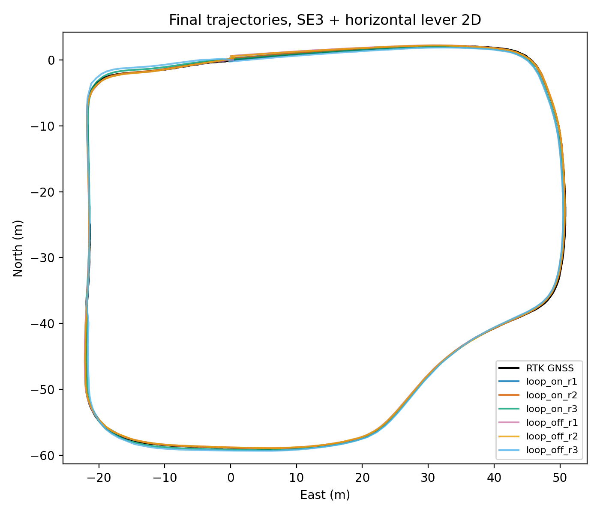
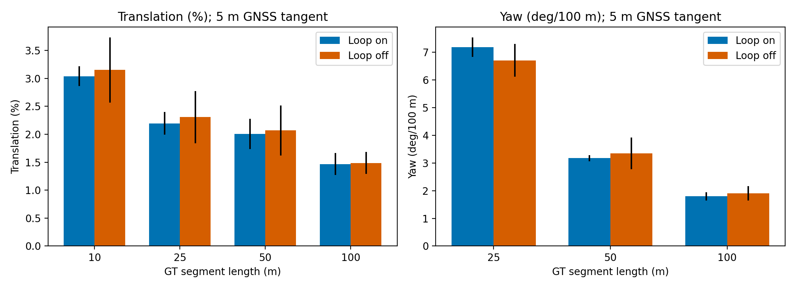
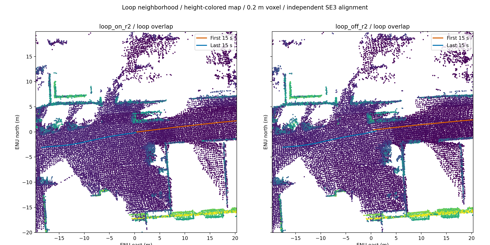
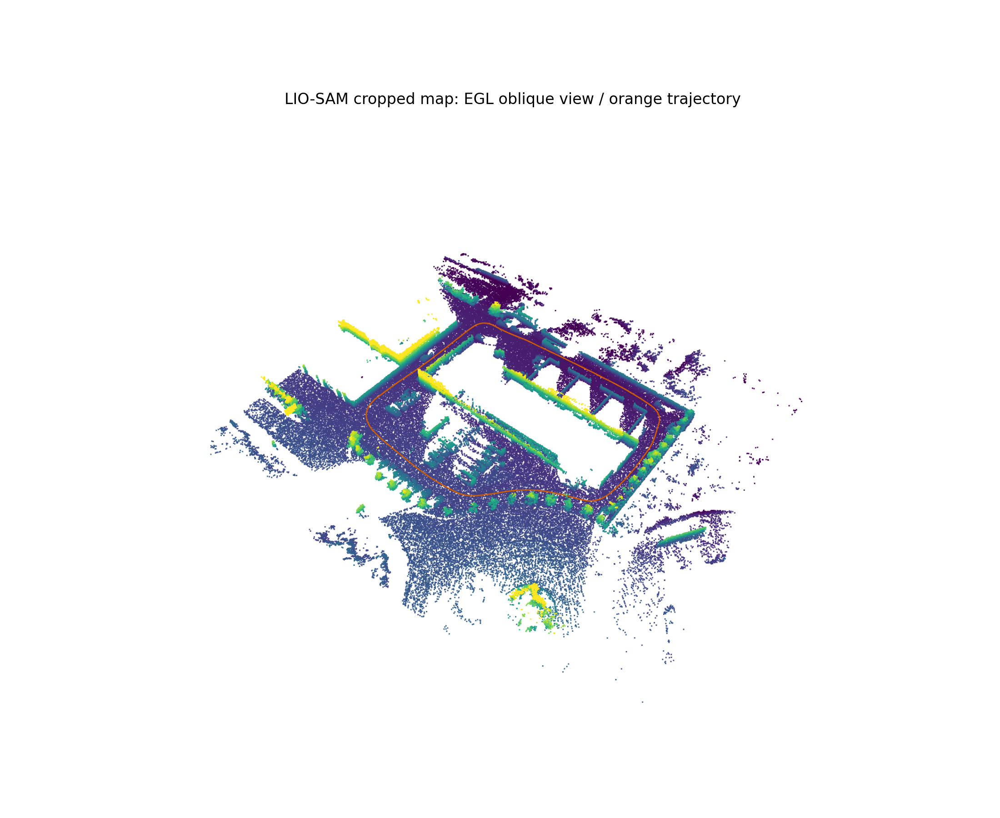
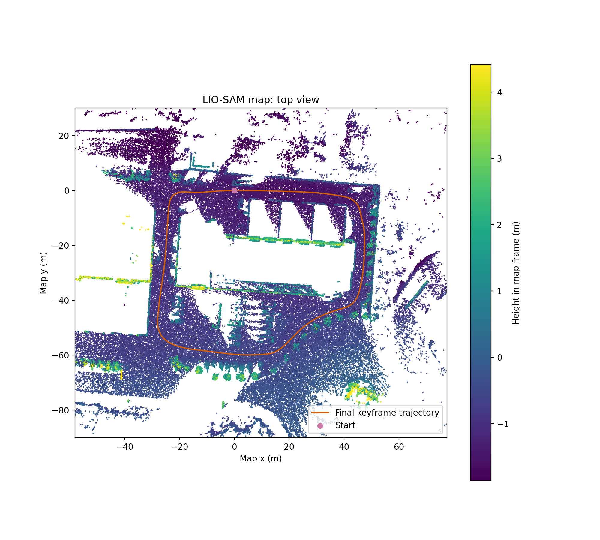
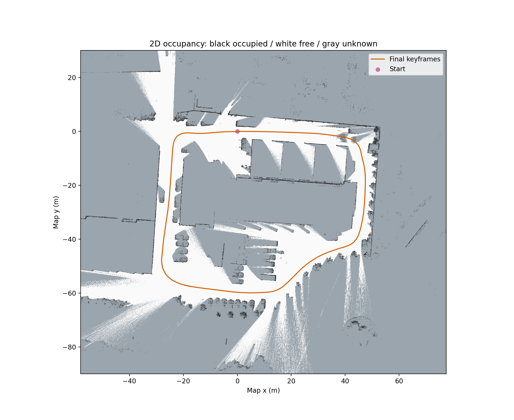
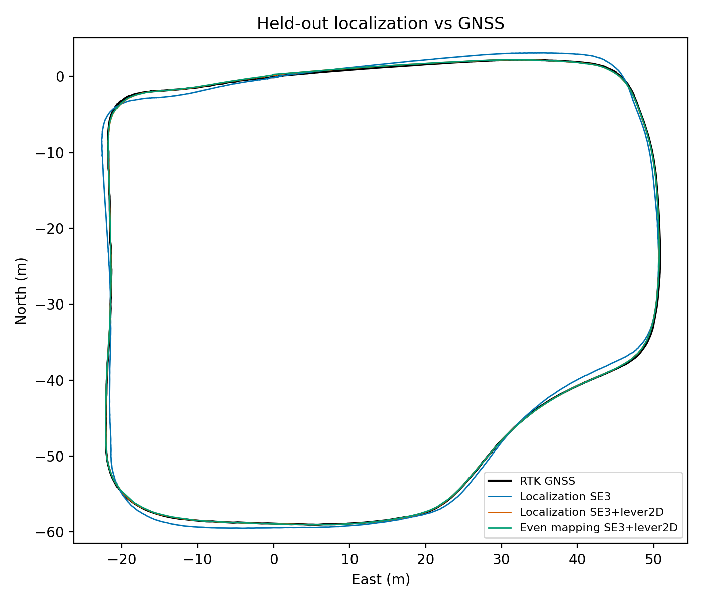
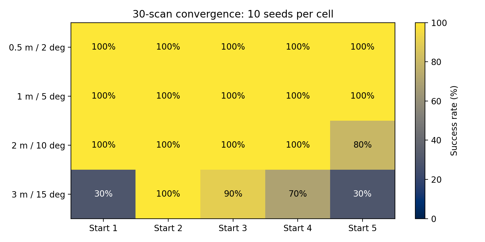

# LiDAR–IMU 매핑과 RTK GNSS 기반 정확도 평가

## 요약

LIO-SAM의 입력 시각·좌표계·실험 기록·평가·지도 내보내기를 연결하는 재현 가능한 파이프라인을 구현했다. GNSS는 매핑 입력에서 제외하고 평가 정답으로만 사용했다.
루프 ON의 수평 ATE는 0.3059 ± 0.1141[^m_loop_on_ate] m, OFF는 0.3893 ± 0.2204[^m_loop_off_ate] m이며, 평균 개선 21.4[^m_improvement]%는 반복 변동보다 작아 통계적 유의성을 입증하지 못한다.
고정 지도에서 홀수 스캔 위치추정 ATE는 0.2589[^m_loc_ate] m이고 평균 실시간 계수는 1.21[^m_loc_rtf]×다. 동일 주행 기반이며 lever 보정도 평가 GT에 적합하므로 **낙관적 추정치**다.

| 헤드라인 | 결과 | 해석 |
|---|---|---|
| 최종 keyframe 2D ATE ON / OFF (m) | 0.3059 ± 0.1141[^m_loop_on_ate] / 0.3893 ± 0.2204[^m_loop_off_ate] | SE3 + 수평 lever 적합, 스케일 없음 |
| even 2D ATE (m) | 0.2396 (n=1)[^m_even_ate] | 단일 실행, 반복 분산 추정 불가 |
| 장거리 RPE ON / OFF (%) | 1.4669 ± 0.1952[^m_loop_on_rpe] / 1.4878 ± 0.1964[^m_loop_off_rpe] | 백 미터 구간, yaw-only 및 lever 보정 |
| 루프 위치 제약 일관성 ON / even | 1.0000 ± 0.0000; 7/7 pairs[^m_loop_on_loop] / 1.0000 (n=1); 2/2 pairs[^m_even_loop] | OFF는 제약 없음; 회전 정답 검증은 아님 |
| 위치추정 2D ATE / SE3-only (m) | 0.2589[^m_loc_ate] / 0.6893[^m_loc_se3] | lever 적합에 따른 낙관성 함께 공개 |
| 초기 오차 강건성 | 180[^m_successes] / 200[^m_trials] | 맵 궤적 기준 수렴, GNSS 정확도와 구별 |
| 평균 실시간 계수 | 1.21[^m_loc_rtf]× | 센서 주기 / 스캔 계산시간 |

수치는 기존 결과에서 읽었으며 새 평가나 집계는 하지 않았다. ±는 표본 표준편차이며 ON/OFF는 각 세 번 반복했다. 수치별 각주는 원본 경로와 추출 위치를 가리킨다. 기하 검증과 과거 RPE 오류는 독립 결과 파일이 없어 설계·리뷰 기록을 명시적으로 인용한다. 데이터 리포트는 현재 `results/data_report`가 아닌 보존된 아카이브에서 읽었다.

## 데이터와 센서

| 센서 / 토픽 | 메시지 수 | 처리 |
|---|---:|---|
| 전방 LiDAR `/front/lidar_point_synced` → `/points_raw` | 2178[^m_lidar_count] | 무효점 제거, ring 유지, 상대 time 생성 |
| IMU `/imu/data_synced` → `/imu_raw` | 10884[^m_imu_count] | 원본 측정 payload 유지 |
| RTK GNSS `/fix_synced` → `/gps/fix` | 3298[^m_gps_count] | 평가 전용, 첫 fix ENU 원점 |

GNSS 누적거리는 238.679[^m_distance] m, 시작–끝 거리는 0.473[^m_closure] m인 평지 폐루프다. LiDAR 모델명은 확정하지 않았다. 원본 기록시각과 헤더 시각이 달라 헤더를 기준으로 bag 시간을 재기록했다. 센서 좌표계는 `front_lidar`, `imu_link`, `gps`이며 외부 파라미터 방향은 실측으로 확인했다.

원본: `results/archive_v1_wrong_rpy/data_report/gnss_traj.png`.

## 파이프라인 아키텍처

업스트림 알고리즘은 유지하고 전처리·설정·실행 래퍼·기록·평가·내보내기를 구현했다. GPS factor 입력 토픽에는 publisher가 없도록 설정했다. 최종 최적화 keyframe을 주 평가 대상으로 쓰며 온라인 odometry는 이미 앞선 루프 업데이트를 포함하므로 두 궤적의 차이를 단일 루프의 순수 효과로 해석하지 않는다.

## 핵심 엔지니어링 이슈와 해결

### 절대 epoch 포인트 시간

포인트 timestamp와 헤더의 평균 오프셋은 169765152.4636848[^m_offset] s, 기록된 표준편차는 0.0[^m_offset_std] s다. 이는 부동소수점 정밀도 내 일치이며 물리적 무오차를 뜻하지 않는다. 스캔 내 최소 timestamp를 빼서 상대 time을 만들었고 최대값은 0.025436163[^m_time_span] s다. 무효점 제거 전 시간 원점을 유지해 유효점 마스크에 따라 deskew 기준이 움직이지 않게 했다.

### 외부 회전의 방향과 orientation convention

지면 법선과 IMU 중력 비교에서 `R.T @ up_imu` 오차는 0.55[^m_normal_error]°였다. 이 수치는 `TASKS.md`의 실측 기록이며 원시 지면 fitting 산출물은 별도로 보존되어 있지 않다. 제공 회전은 LiDAR→IMU이므로 가속도에는 `extrinsicRot=R.T`를 적용한다. 반면 orientation은 오른쪽에서 곱하므로 `extrinsicRPY=R`이어야 두 변환이 상쇄된다.

| 항목 | 잘못된 RPY 아카이브 | 정정 후 |
|---|---|---|
| 회전 설정 | Rot와 RPY 모두 R.T | Rot=R.T, RPY=R |
| 세계 중력축 기울기 (°) | 18.569[^m_gravity_v1] | 0.095[^m_gravity_v2] |
| 저장 궤적 누적거리 (m) | 2088.579[^m_v1_distance] | 234.507[^m_v2_distance] |
| 거리 sanity | 실패한 파일럿 | True[^m_v2_success] |

위 거리는 v1 파일럿과 v2 정정 배치의 예시이며 동일 반복의 통제 비교가 아니다. 회전 불일치는 중력 진단으로 확인했으나 발산의 유일한 원인으로 확정하지 않는다. 실행 준비·DDS discovery 타이밍에 따른 even 실패도 별도 보존했다.[^history]

### RPE 좌표계와 lever 관측성

초기 리뷰의 약 17[^m_old_rpe]% RPE는 장착 pitch 약 9.3[^m_pitch]°를 포함한 LiDAR 회전과 평면 GT heading을 비교한 체계 오차였다. 정렬 뒤 yaw만 추출하고 수평 lever로 보정한 안테나 위치를 사용해 RPE와 ATE의 평가 원점을 맞췄다. GT yaw는 5[^m_tangent] m 중심 접선 근사라 코너에서 오차가 남는다.

평면 운동에서 자유로운 3-DoF lever는 수직 성분과 전역 이동이 약하게 분리되어 과대 추정될 수 있다. 수직 성분을 고정한 수평 2-DoF 모델로 제한했다. 전체 일곱 final run의 수평 x 성분은 -1.5578 ± 0.0668[^m_lever_all] m로 일관적이다. 이는 기울어진 LiDAR 축 성분이 아니라 yaw-only ENU heading 좌표의 오프셋이며 독립 캘리브레이션이 아니다.

### 저장 경로 가드와 루프 판정

업스트림 save_map은 `$HOME + destination`에 `rm -r`을 수행한다. 실행 래퍼는 전용 run 하위 `map` 경로만 허용하고 빈 문자열·루트·상위 디렉터리·기존 run을 거부한다. 저장 실패도 run 실패로 기록한다.[^safety]

루프의 정답 여부를 GT 두 점의 거리만으로 판정하면 가까운 재방문을 놓칠 수 있다. 기록된 실제 marker endpoint를 최종 keyframe에 매칭하고, 정렬된 상대 위치 벡터와 동시각 GT 상대 벡터의 오차가 0.5[^m_loop_threshold] m 미만인지 검증했다. ON/OFF 후보 fitness 변경과 전체 배치 재실행도 아카이브에 남겼다. 이 검사는 위치 일관성만 평가하며 ICP 회전의 독립 정답 검사는 아니다.[^history]

## 실험 결과

원본: `results/eval/figs/traj_on_vs_off.png`.

| 최종 궤적 지표 | ON | OFF | even |
|---|---|---|---|
| SE3 + lever 2D ATE RMSE (m) | 0.3059 ± 0.1141[^m_loop_on_ate] | 0.3893 ± 0.2204[^m_loop_off_ate] | 0.2396 (n=1)[^m_even_ate] |
| SE3-only 2D ATE RMSE (m) | 0.7176[^m_loop_on_se3_mean] ± 0.0587[^m_loop_on_se3_std_sample] | 0.7928[^m_loop_off_se3_mean] ± 0.1193[^m_loop_off_se3_std_sample] | 전체 표 참조[^eval] |
| 종점 변위 벡터 오차 (m) | 0.2554 ± 0.1021[^m_loop_on_endpoint] | 0.3917 ± 0.2054[^m_loop_off_endpoint] | 0.2699 (n=1)[^m_even_endpoint] |
| 백 미터 RPE 병진 (%) | 1.4669 ± 0.1952[^m_loop_on_rpe] | 1.4878 ± 0.1964[^m_loop_off_rpe] | 1.3299 (n=1)[^m_even_rpe] |

ATE 평균차는 0.0834[^m_delta] m, 상대 감소는 21.4[^m_improvement]%다. 각 세 번의 표준편차 안에 있는 작은 차이이므로 **통계적으로 유의하다고 주장할 수 없다**. even 결과를 추가 반복으로 섞지 않았다. 종점 지표는 동시각 GT 변위 벡터 대비 오차이며 단순 시작–끝 거리와 다르다. 스케일은 적합하지 않는다.

원본: `results/eval/figs/rpe_bar.png`.

| 맵 품질 (반복 평균 ± 표본 표준편차) | ON | OFF |
|---|---|---|
| MME (nats) | -3.696387[^m_loop_on_mme_nats_mean] ± 0.013002[^m_loop_on_mme_nats_std_sample] | -3.720830[^m_loop_off_mme_nats_mean] ± 0.019089[^m_loop_off_mme_nats_std_sample] |
| MPV (m²) | 0.001755[^m_loop_on_mpv_m2_mean] ± 0.000049[^m_loop_on_mpv_m2_std_sample] | 0.001745[^m_loop_off_mpv_m2_mean] ± 0.000025[^m_loop_off_mpv_m2_std_sample] |
| 겹침 NN median (m) | 0.124365[^m_loop_on_overlap_median_m_mean] ± 0.028998[^m_loop_on_overlap_median_m_std_sample] | 0.122330[^m_loop_off_overlap_median_m_mean] ± 0.022603[^m_loop_off_overlap_median_m_std_sample] |
| 겹침 NN p95 (m) | 0.723148[^m_loop_on_overlap_p95_m_mean] ± 0.009750[^m_loop_on_overlap_p95_m_std_sample] | 0.745948[^m_loop_off_overlap_p95_m_mean] ± 0.015472[^m_loop_off_overlap_p95_m_std_sample] |
| 큰 겹침 오차 비율 | 0.345409[^m_loop_on_double_wall_ratio_mean] ± 0.067190[^m_loop_on_double_wall_ratio_std_sample] | 0.358152[^m_loop_off_double_wall_ratio_mean] ± 0.038261[^m_loop_off_double_wall_ratio_std_sample] |

동일 voxel·이웃 반경·최소 이웃 수·고유값 하한과 GNSS XY crop을 적용했다. 정확한 설정은 원본 평가 요약에 있다.[^eval] MME는 미분 엔트로피라 음수일 수 있고 MPV는 평면 분산이다. 겹침은 처음/마지막 시간창의 양방향 최근접 거리이며 coverage gating을 적용했다. 큰 오차 비율은 가시성과 샘플링 차이도 포함하므로 의미론적 이중 벽 검출률이 아니다. 맵 내부 품질에서 ON의 일관된 우위를 주장하지 않는다.

원본: `results/maps/loop_on_r2/map_loop_overlap.png`.

## 지도 산출물

ON final 보정 ATE의 중앙값 run인 `loop_on_r2`를 대표로 선정했다. 원본 intensity 포함 PCD, voxel PCD, crop PCD 및 SE3 ENU 정렬 PCD를 함께 보존했다. ENU 지도에는 lever 적합을 적용하지 않았다.

원본: `results/maps/loop_on_r2/map_oblique.png`.

원본: `results/maps/loop_on_r2/map_top.png`.

원본: `results/maps/loop_on_r2/map2d.png`.

Nav2 산출물은 `map2d.pgm`과 단일 `map2d.yaml`이다. 해상도는 0.05[^m_map_resolution] m이며 궤적 버퍼 내부 unknown 비율은 0.7364[^m_map_unknown]다. 미관측 영역을 free로 채우지 않았다. 지면 상대 높이 슬라이스와 ray casting 기반으로 생성했고 최종 keyframe 보간 자세를 사용한다. 지도는 robot footprint inflation이나 실제 Nav2 구동 검증을 포함하지 않는다.[^maps]

## 맵 기반 재주행 테스트

짝수 스캔으로 prior를 만들고 홀수 스캔을 고정 prior에 GICP 정합했다. 위치추정은 이전 출력 포즈 기반 등속·등각속도 예측을 사용하며 IMU/GNSS나 매 스캔 매핑 포즈를 추적 입력에 넣지 않았다. 최초 포즈만 매핑 기준으로 초기화했다. 초기 prior 생성과 bag I/O를 제외한 스캔 전처리·예측·정합 시간을 계측했다.[^loc]

전체 1089[^m_loc_scans] 스캔을 처리했고 실패는 0[^m_loc_failures]회다. GT 시각 범위 내 ATE 매칭은 1088[^m_loc_matched]개로, 전체 처리 개수와 구별한다. Fitness 평균 0.9998[^m_loc_fitness], 계산시간 평균 82.6[^m_loc_ms] ms / p95 170.0[^m_loc_p95] ms / 최대 379.5[^m_loc_max_ms] ms, 최대 RSS 523.1[^m_loc_rss] MiB다. 평균 실시간 계수 1.21[^m_loc_rtf]×는 모든 스캔의 deadline을 보장하지 않는다.

원본: `results/loc/figs/loc_traj_overlay.png`.

| 초기 위치 / yaw 섭동 | 성공 / 시도 | 성공률 |
|---|---|---|
| 0.5 m / 2° | 50/50 | 100%[^m_robust_0] |
| 1 m / 5° | 50/50 | 100%[^m_robust_1] |
| 2 m / 10° | 48/50 | 96%[^m_robust_2] |
| 3 m / 15° | 32/50 | 64%[^m_robust_3] |

섭동 크기와 수렴 기준은 아래 히트맵 및 원본 summary를 참조한다.[^loc] 위 표의 각 셀은 원본 집계값을 그대로 인용했다. 수렴 판정은 even 매핑 궤적에 대한 맵 좌표 오차이며 GNSS 정확도 주장이 아니다.

원본: `results/loc/figs/robustness_heatmap.png`.

공통 시각에서 위치추정/매핑 보정 ATE는 각각 0.2586[^m_loc_common] / 0.2586[^m_map_common] m다. 재정합이 매핑보다 독립적으로 더 정확해졌다는 증거는 없다. 이 실험에서 고정 맵의 정확도가 위치추정 오차의 실질적 하한을 제한한다고 해석하되, 보편적인 수학적 하한으로 주장하지 않는다.

## 한계와 다음 단계

- 같은 날 단일 주행과 작은 반복 표본이므로 다른 환경에 일반화할 수 없다. 동일 주행 even/odd split은 겹치는 장면을 공유해 진짜 재주행보다 낙관적이다.
- LIO-SAM 입력에는 상대 time을 제공하지만 최종 포즈 기반 평가용 맵 재구성과 위치추정 query에는 포인트별 deskew가 없다.
- GT 접선 yaw는 평지 근사이며 코너에서 불확실하다. GNSS 안테나 lever는 같은 GT에 in-sample 적합해 일부 궤적 변형을 흡수할 수 있다.
- IMU–LiDAR translation은 원본 lever를 그대로 사용했으며 회전에 따른 미세 차이는 독립 보정하지 않았다.[^design]
- 다른 날 bag과 독립 초기 자세·안테나 캘리브레이션으로 재주행을 검증하고, deskew를 포함한 재구성과 실제 Nav2 로딩을 확인할 필요가 있다.
- GPS factor 융합은 별도 실험으로 분리하고 평가 GT와 독립된 센서·구간으로 누출을 통제해야 한다.

[^eval]: [최신 TASK-05 평가](../results/eval/summary.md). 과거 `tools/eval/README.md`의 접선·lever·루프 판정 설명보다 이 rev2 결과를 우선한다.
[^history]: [v1 잘못된 RPY](../results/archive_v1_wrong_rpy/ARCHIVE_NOTE.md), [v2 fitness 배치](../results/archive_v2_fitness03/ARCHIVE_NOTE.md), [v3 marker 기록 전](../results/archive_v3_preloop_pairs/ARCHIVE_NOTE.md), [실패 even 시도](../results/archive_v3_failed_attempts/ARCHIVE_NOTE.md), [실행 이력](../logs/task03_04.md).
[^safety]: [실행 래퍼](../tools/run_lio_sam.py), [경로 보호 테스트](../tools/tests/test_run_safety.py).
[^maps]: [지도 구현·제약](../tools/maps/README.md), [최신 지도 검증](../results/maps/loop_on_r2/validation.json).
[^loc]: [위치추정 결과·섭동 크기·수렴 기준](../results/loc/summary.md), [독립 검증](../results/loc/verification.json).
[^design]: [설계와 캘리브레이션 기록](../TASKS.md).

[^m_loop_on_ate]: [results/eval/summary.md](../results/eval/summary.md); selector: `{"pattern": "^\\| loop_on \\| \\d+ \\| ([^|]+?) \\|"}`.
[^m_loop_off_ate]: [results/eval/summary.md](../results/eval/summary.md); selector: `{"pattern": "^\\| loop_off \\| \\d+ \\| ([^|]+?) \\|"}`.
[^m_improvement]: [results/eval/summary.md](../results/eval/summary.md); selector: `{"pattern": "\\((21\\.4)% reduction;"}`.
[^m_loc_ate]: [results/loc/localization/metrics.json](../results/loc/localization/metrics.json); selector: `{"pointer": ["se3_lever", "ate_2d_m", "rmse"], "format": ".4f"}`.
[^m_loc_rtf]: [results/loc/run_stats.json](../results/loc/run_stats.json); selector: `{"pointer": ["realtime_factor_10hz"], "format": ".2f"}`.
[^m_even_ate]: [results/eval/summary.md](../results/eval/summary.md); selector: `{"pattern": "^\\| even \\| \\d+ \\| ([^|]+?) \\|"}`.
[^m_loop_on_rpe]: [results/eval/summary.md](../results/eval/summary.md); selector: `{"pattern": "^\\| loop_on \\| \\d+ \\| [^|]+ \\| [^|]+ \\| ([^|]+?) \\|"}`.
[^m_loop_off_rpe]: [results/eval/summary.md](../results/eval/summary.md); selector: `{"pattern": "^\\| loop_off \\| \\d+ \\| [^|]+ \\| [^|]+ \\| ([^|]+?) \\|"}`.
[^m_loop_on_loop]: [results/eval/summary.md](../results/eval/summary.md); selector: `{"pattern": "^\\| loop_on \\| \\d+ \\| [^|]+ \\| [^|]+ \\| [^|]+ \\| ([^|]+?) \\|"}`.
[^m_even_loop]: [results/eval/summary.md](../results/eval/summary.md); selector: `{"pattern": "^\\| even \\| \\d+ \\| [^|]+ \\| [^|]+ \\| [^|]+ \\| ([^|]+?) \\|"}`.
[^m_loc_se3]: [results/loc/localization/metrics.json](../results/loc/localization/metrics.json); selector: `{"pointer": ["se3", "ate_2d_m", "rmse"], "format": ".4f"}`.
[^m_successes]: [results/loc/run_stats.json](../results/loc/run_stats.json); selector: `{"pointer": ["robustness_successes"]}`.
[^m_trials]: [results/loc/run_stats.json](../results/loc/run_stats.json); selector: `{"pointer": ["robustness_trials"]}`.
[^m_lidar_count]: [results/archive_v1_wrong_rpy/data_report/statistics.json](../results/archive_v1_wrong_rpy/data_report/statistics.json); selector: `{"pointer": ["message_counts", "/points_raw"]}`.
[^m_imu_count]: [results/archive_v1_wrong_rpy/data_report/statistics.json](../results/archive_v1_wrong_rpy/data_report/statistics.json); selector: `{"pointer": ["message_counts", "/imu_raw"]}`.
[^m_gps_count]: [results/archive_v1_wrong_rpy/data_report/statistics.json](../results/archive_v1_wrong_rpy/data_report/statistics.json); selector: `{"pointer": ["message_counts", "/gps/fix"]}`.
[^m_distance]: [logs/task02.md](../logs/task02.md); selector: `{"pattern": "누적거리 ([\\d.]+) m"}`.
[^m_closure]: [logs/task02.md](../logs/task02.md); selector: `{"pattern": "시작–끝 거리 ([\\d.]+) m"}`.
[^m_offset]: [results/archive_v1_wrong_rpy/data_report/statistics.json](../results/archive_v1_wrong_rpy/data_report/statistics.json); selector: `{"pointer": ["offset_mean_s"]}`.
[^m_offset_std]: [results/archive_v1_wrong_rpy/data_report/statistics.json](../results/archive_v1_wrong_rpy/data_report/statistics.json); selector: `{"pointer": ["offset_std_s"]}`.
[^m_time_span]: [logs/task02.md](../logs/task02.md); selector: `{"pattern": "전체 출력 time 범위 \\[0\\.000000000, ([\\d.]+)\\] s"}`.
[^m_normal_error]: [TASKS.md](../TASKS.md); selector: `{"pattern": "`R.T @ up_imu` 오차 ([\\d.]+)°"}`.
[^m_gravity_v1]: [results/archive_v1_wrong_rpy/imu_frame_diagnostic.json](../results/archive_v1_wrong_rpy/imu_frame_diagnostic.json); selector: `{"pointer": ["configured_gravity_tilt_deg"], "format": ".3f"}`.
[^m_gravity_v2]: [results/imu_frame_diagnostic.json](../results/imu_frame_diagnostic.json); selector: `{"pointer": ["configured_gravity_tilt_deg"], "format": ".3f"}`.
[^m_v1_distance]: [results/archive_v1_wrong_rpy/pilot_rate1/run_meta.json](../results/archive_v1_wrong_rpy/pilot_rate1/run_meta.json); selector: `{"pointer": ["distance_m"], "format": ".3f"}`.
[^m_v2_distance]: [results/archive_v2_fitness03/loop_on_r1/run_meta.json](../results/archive_v2_fitness03/loop_on_r1/run_meta.json); selector: `{"pointer": ["distance_m"], "format": ".3f"}`.
[^m_v2_success]: [results/archive_v2_fitness03/loop_on_r1/run_meta.json](../results/archive_v2_fitness03/loop_on_r1/run_meta.json); selector: `{"pointer": ["sanity_pass"]}`.
[^m_old_rpe]: [TASKS.md](../TASKS.md); selector: `{"pattern": "\\*\\*RPE 병진 (\\d+)%는 버그"}`.
[^m_pitch]: [results/eval/summary.md](../results/eval/summary.md); selector: `{"pattern": "approximately ([\\d.]+)° LiDAR mounting pitch"}`.
[^m_tangent]: [results/eval/summary.md](../results/eval/summary.md); selector: `{"pattern": "GT yaw is a centered ([\\d]+) m trajectory tangent"}`.
[^m_lever_all]: [results/eval/summary.md](../results/eval/summary.md); selector: `{"pattern": "^\\| all seven / final \\| 7 \\| ([^|]+?) \\|"}`.
[^m_loop_threshold]: [results/eval/summary.md](../results/eval/summary.md); selector: `{"pattern": "\\|\\|Δ\\|\\| <([\\d.]+) m"}`.
[^m_loop_on_se3_mean]: [results/eval/group_summary.csv](../results/eval/group_summary.csv); selector: `{"row": {"group": "loop_on", "trajectory": "final", "metric": "ate_se3_2d_rmse_m"}, "column": "mean", "format": ".4f"}`.
[^m_loop_on_se3_std_sample]: [results/eval/group_summary.csv](../results/eval/group_summary.csv); selector: `{"row": {"group": "loop_on", "trajectory": "final", "metric": "ate_se3_2d_rmse_m"}, "column": "std_sample", "format": ".4f"}`.
[^m_loop_off_se3_mean]: [results/eval/group_summary.csv](../results/eval/group_summary.csv); selector: `{"row": {"group": "loop_off", "trajectory": "final", "metric": "ate_se3_2d_rmse_m"}, "column": "mean", "format": ".4f"}`.
[^m_loop_off_se3_std_sample]: [results/eval/group_summary.csv](../results/eval/group_summary.csv); selector: `{"row": {"group": "loop_off", "trajectory": "final", "metric": "ate_se3_2d_rmse_m"}, "column": "std_sample", "format": ".4f"}`.
[^m_loop_on_endpoint]: [results/eval/summary.md](../results/eval/summary.md); selector: `{"pattern": "^\\| loop_on \\| \\d+ \\| [^|]+ \\| ([^|]+?) \\|"}`.
[^m_loop_off_endpoint]: [results/eval/summary.md](../results/eval/summary.md); selector: `{"pattern": "^\\| loop_off \\| \\d+ \\| [^|]+ \\| ([^|]+?) \\|"}`.
[^m_even_endpoint]: [results/eval/summary.md](../results/eval/summary.md); selector: `{"pattern": "^\\| even \\| \\d+ \\| [^|]+ \\| ([^|]+?) \\|"}`.
[^m_even_rpe]: [results/eval/summary.md](../results/eval/summary.md); selector: `{"pattern": "^\\| even \\| \\d+ \\| [^|]+ \\| [^|]+ \\| ([^|]+?) \\|"}`.
[^m_delta]: [results/eval/summary.md](../results/eval/summary.md); selector: `{"pattern": "OFF−ON = ([\\d.]+) m"}`.
[^m_loop_on_mme_nats_mean]: [results/eval/group_summary.csv](../results/eval/group_summary.csv); selector: `{"row": {"group": "loop_on", "trajectory": "map", "metric": "mme_nats"}, "column": "mean", "format": ".6f"}`.
[^m_loop_on_mme_nats_std_sample]: [results/eval/group_summary.csv](../results/eval/group_summary.csv); selector: `{"row": {"group": "loop_on", "trajectory": "map", "metric": "mme_nats"}, "column": "std_sample", "format": ".6f"}`.
[^m_loop_off_mme_nats_mean]: [results/eval/group_summary.csv](../results/eval/group_summary.csv); selector: `{"row": {"group": "loop_off", "trajectory": "map", "metric": "mme_nats"}, "column": "mean", "format": ".6f"}`.
[^m_loop_off_mme_nats_std_sample]: [results/eval/group_summary.csv](../results/eval/group_summary.csv); selector: `{"row": {"group": "loop_off", "trajectory": "map", "metric": "mme_nats"}, "column": "std_sample", "format": ".6f"}`.
[^m_loop_on_mpv_m2_mean]: [results/eval/group_summary.csv](../results/eval/group_summary.csv); selector: `{"row": {"group": "loop_on", "trajectory": "map", "metric": "mpv_m2"}, "column": "mean", "format": ".6f"}`.
[^m_loop_on_mpv_m2_std_sample]: [results/eval/group_summary.csv](../results/eval/group_summary.csv); selector: `{"row": {"group": "loop_on", "trajectory": "map", "metric": "mpv_m2"}, "column": "std_sample", "format": ".6f"}`.
[^m_loop_off_mpv_m2_mean]: [results/eval/group_summary.csv](../results/eval/group_summary.csv); selector: `{"row": {"group": "loop_off", "trajectory": "map", "metric": "mpv_m2"}, "column": "mean", "format": ".6f"}`.
[^m_loop_off_mpv_m2_std_sample]: [results/eval/group_summary.csv](../results/eval/group_summary.csv); selector: `{"row": {"group": "loop_off", "trajectory": "map", "metric": "mpv_m2"}, "column": "std_sample", "format": ".6f"}`.
[^m_loop_on_overlap_median_m_mean]: [results/eval/group_summary.csv](../results/eval/group_summary.csv); selector: `{"row": {"group": "loop_on", "trajectory": "map", "metric": "overlap_median_m"}, "column": "mean", "format": ".6f"}`.
[^m_loop_on_overlap_median_m_std_sample]: [results/eval/group_summary.csv](../results/eval/group_summary.csv); selector: `{"row": {"group": "loop_on", "trajectory": "map", "metric": "overlap_median_m"}, "column": "std_sample", "format": ".6f"}`.
[^m_loop_off_overlap_median_m_mean]: [results/eval/group_summary.csv](../results/eval/group_summary.csv); selector: `{"row": {"group": "loop_off", "trajectory": "map", "metric": "overlap_median_m"}, "column": "mean", "format": ".6f"}`.
[^m_loop_off_overlap_median_m_std_sample]: [results/eval/group_summary.csv](../results/eval/group_summary.csv); selector: `{"row": {"group": "loop_off", "trajectory": "map", "metric": "overlap_median_m"}, "column": "std_sample", "format": ".6f"}`.
[^m_loop_on_overlap_p95_m_mean]: [results/eval/group_summary.csv](../results/eval/group_summary.csv); selector: `{"row": {"group": "loop_on", "trajectory": "map", "metric": "overlap_p95_m"}, "column": "mean", "format": ".6f"}`.
[^m_loop_on_overlap_p95_m_std_sample]: [results/eval/group_summary.csv](../results/eval/group_summary.csv); selector: `{"row": {"group": "loop_on", "trajectory": "map", "metric": "overlap_p95_m"}, "column": "std_sample", "format": ".6f"}`.
[^m_loop_off_overlap_p95_m_mean]: [results/eval/group_summary.csv](../results/eval/group_summary.csv); selector: `{"row": {"group": "loop_off", "trajectory": "map", "metric": "overlap_p95_m"}, "column": "mean", "format": ".6f"}`.
[^m_loop_off_overlap_p95_m_std_sample]: [results/eval/group_summary.csv](../results/eval/group_summary.csv); selector: `{"row": {"group": "loop_off", "trajectory": "map", "metric": "overlap_p95_m"}, "column": "std_sample", "format": ".6f"}`.
[^m_loop_on_double_wall_ratio_mean]: [results/eval/group_summary.csv](../results/eval/group_summary.csv); selector: `{"row": {"group": "loop_on", "trajectory": "map", "metric": "double_wall_ratio"}, "column": "mean", "format": ".6f"}`.
[^m_loop_on_double_wall_ratio_std_sample]: [results/eval/group_summary.csv](../results/eval/group_summary.csv); selector: `{"row": {"group": "loop_on", "trajectory": "map", "metric": "double_wall_ratio"}, "column": "std_sample", "format": ".6f"}`.
[^m_loop_off_double_wall_ratio_mean]: [results/eval/group_summary.csv](../results/eval/group_summary.csv); selector: `{"row": {"group": "loop_off", "trajectory": "map", "metric": "double_wall_ratio"}, "column": "mean", "format": ".6f"}`.
[^m_loop_off_double_wall_ratio_std_sample]: [results/eval/group_summary.csv](../results/eval/group_summary.csv); selector: `{"row": {"group": "loop_off", "trajectory": "map", "metric": "double_wall_ratio"}, "column": "std_sample", "format": ".6f"}`.
[^m_map_resolution]: [results/maps/loop_on_r2/map2d_stats.json](../results/maps/loop_on_r2/map2d_stats.json); selector: `{"pointer": ["config", "resolution"]}`.
[^m_map_unknown]: [results/maps/loop_on_r2/map2d_stats.json](../results/maps/loop_on_r2/map2d_stats.json); selector: `{"pointer": ["driving_region", "unknown_fraction"], "format": ".4f"}`.
[^m_loc_scans]: [results/loc/run_stats.json](../results/loc/run_stats.json); selector: `{"pointer": ["scans"]}`.
[^m_loc_failures]: [results/loc/run_stats.json](../results/loc/run_stats.json); selector: `{"pointer": ["failures"]}`.
[^m_loc_matched]: [results/loc/localization/metrics.json](../results/loc/localization/metrics.json); selector: `{"pointer": ["matched_count"]}`.
[^m_loc_fitness]: [results/loc/run_stats.json](../results/loc/run_stats.json); selector: `{"pointer": ["mean_fitness"], "format": ".4f"}`.
[^m_loc_ms]: [results/loc/run_stats.json](../results/loc/run_stats.json); selector: `{"pointer": ["mean_ms"], "format": ".1f"}`.
[^m_loc_p95]: [results/loc/run_stats.json](../results/loc/run_stats.json); selector: `{"pointer": ["p95_ms"], "format": ".1f"}`.
[^m_loc_max_ms]: [results/loc/run_stats.json](../results/loc/run_stats.json); selector: `{"pointer": ["max_ms"], "format": ".1f"}`.
[^m_loc_rss]: [results/loc/run_stats.json](../results/loc/run_stats.json); selector: `{"pointer": ["peak_rss_mib"], "format": ".1f"}`.
[^m_robust_0]: [results/loc/summary.md](../results/loc/summary.md); selector: `{"pattern": "^\\| (0\\.5\\ m\\ /\\ 2° \\| [^\\n]+?) \\|$"}`.
[^m_robust_1]: [results/loc/summary.md](../results/loc/summary.md); selector: `{"pattern": "^\\| (1\\ m\\ /\\ 5° \\| [^\\n]+?) \\|$"}`.
[^m_robust_2]: [results/loc/summary.md](../results/loc/summary.md); selector: `{"pattern": "^\\| (2\\ m\\ /\\ 10° \\| [^\\n]+?) \\|$"}`.
[^m_robust_3]: [results/loc/summary.md](../results/loc/summary.md); selector: `{"pattern": "^\\| (3\\ m\\ /\\ 15° \\| [^\\n]+?) \\|$"}`.
[^m_loc_common]: [results/loc/localization_common_timestamps/metrics.json](../results/loc/localization_common_timestamps/metrics.json); selector: `{"pointer": ["se3_lever", "ate_2d_m", "rmse"], "format": ".4f"}`.
[^m_map_common]: [results/loc/mapping_common_timestamps/metrics.json](../results/loc/mapping_common_timestamps/metrics.json); selector: `{"pointer": ["se3_lever", "ate_2d_m", "rmse"], "format": ".4f"}`.
